# UN4 S3 — Lista geral A (com diagramas)

Símbolos: AND entrada reta; OR entrada curva; NOT triângulo com bolha; XOR = OR com traço extra. Entradas à esquerda, saída à direita.
Em a/b/c, responda o que o item pede. Bolha no pino = inversão naquele ponto.

## Desenhar o circuito

Monte no caderno (símbolos padronizados). O gabarito no fim traz o diagrama montado.

### Exercício 1 — AND seguida de NOT

Monte com os símbolos do cabeçalho (AND reta, OR curva, NOT com bolha).

a) Desenhe: A e B entram numa AND; a saída da AND entra numa NOT; S é a saída da NOT.
b) Esse circuito equivale a qual porta de um bloco só?
c) A=1 e B=1: S vale quanto? Primeiro a AND; depois inverta.

### Exercício 2 — OR com bolha (NOR)

Bolha no pino = inversão. OR com bolha na saída = NOR.

a) Desenhe: A e B entram numa OR; coloque bolha na saída; S é esse pino.
b) Qual o nome do bloco com um símbolo só?
c) A=0 e B=0: S vale quanto? Primeiro a OR; depois inverta.

### Exercício 3 — Duas AND e uma OR

Monte com os símbolos do cabeçalho (AND reta, OR curva, NOT com bolha).

a) Desenhe: A e B entram numa AND; C e D entram noutra AND; as duas saídas entram numa OR; S é a saída da OR.
b) Escreva S em função de A, B, C e D.
c) A=B=1, C=0, D=1: S vale quanto? AND primeiro; depois OR.

### Exercício 4 — NOT em A e AND com B

Monte com os símbolos do cabeçalho (AND reta, OR curva, NOT com bolha).

a) Desenhe: A passa por um NOT; a saída desse NOT e B entram numa AND; S é a saída da AND.
b) Escreva S.
c) A=0 e B=1: primeiro inverta A; depois AND com B.

### Exercício 5 — NAND amarrada (NOT)

Ligue as duas entradas no mesmo bit A. NAND(A,A) vira NOT.

a) Desenhe: Uma NAND com as duas entradas amarradas no mesmo fio A; S é a saída.
b) Esse bloco equivale a qual porta?
c) A=0: S vale quanto?

### Exercício 6 — XOR com bolha (XNOR)

XOR: OR com traço extra. Bolha na saída = XNOR (1 se iguais).

a) Desenhe: A e B entram numa XOR; coloque bolha na saída; S é esse pino.
b) Qual o nome do bloco?
c) A=1 e B=1: S vale quanto?

### Exercício 7 — Porta automática enxuta

S=1 abre. p=pessoa, q=abrir, z=fechar. Enxuta: S=(p+q)z'. z=1 impede abrir.

a) Desenhe: p e q entram numa OR; z entra num NOT; a OR e o NOT entram numa AND; S é a saída da AND.
b) Escreva S.
c) p=1, q=0 e z=1: primeiro (p+q) e z'; depois AND.

### Exercício 8 — AND de três entradas

AND de vários bits só vale 1 se todos forem 1.

a) Desenhe: A, B e C entram numa AND de três entradas; S é a saída.
b) Quantas entradas tem o bloco?
c) A=B=1 e C=0: S vale quanto?

### Exercício 9 — OR depois AND

Monte com os símbolos do cabeçalho (AND reta, OR curva, NOT com bolha).

a) Desenhe: A e B entram numa OR; a saída dessa OR e C entram numa AND; S é a saída da AND.
b) Escreva S.
c) A=0, B=1 e C=1: primeiro a OR; depois AND com C.

### Exercício 10 — NOR

NOR = OR com bolha na saída. Só vale 1 se todos forem 0.

a) Desenhe: A e B entram numa NOR (contorno da OR com bolha na saída).
b) Qual o nome do bloco?
c) A=1 e B=0: S vale quanto?

### Exercício 11 — Duas NOT em série

Duas inversões se cancelam: (A')'=A.

a) Desenhe: A entra num NOT; a saída desse NOT entra noutro NOT; S é a saída do segundo.
b) S devolve A ou A'?
c) A=1: calcule da esquerda para a direita.

### Exercício 12 — AND, OR e NOT

Monte com os símbolos do cabeçalho (AND reta, OR curva, NOT com bolha).

a) Desenhe: A e B entram numa AND; a saída da AND e C entram numa OR; a saída da OR entra numa NOT; S é a saída da NOT.
b) Escreva S.
c) A=1, B=1 e C=0: AND, depois OR, depois NOT.

### Exercício 13 — XOR depois AND

⊕ é XOR: 1 se diferentes. AND só vale 1 se todos forem 1.

a) Desenhe: A e B entram numa XOR; a saída da XOR e C entram numa AND; S é a saída da AND.
b) Escreva S.
c) A=1, B=0 e C=1: primeiro XOR; depois AND com C.

### Exercício 14 — Enable

En=1 libera A; En=0 força S=0. S=En·A.

a) Desenhe: Enable: En e A entram numa AND; S é a saída.
b) En=0 bloqueia ou libera?
c) En=0 e A=1: S vale quanto?

### Exercício 15 — AND compartilhando A

Monte com os símbolos do cabeçalho (AND reta, OR curva, NOT com bolha).

a) Desenhe: A e B entram numa AND; A e C entram noutra AND; as duas saídas entram numa OR; S é a saída da OR.
b) Escreva S (é A·B + A·C).
c) A=1, B=0 e C=1: as duas AND, depois OR.

### Exercício 16 — NOT em A e B, depois AND

De Morgan: A'·B' = (A+B)'.

a) Desenhe: A entra num NOT e B entra noutro NOT; os dois NOT entram numa AND; S é a saída da AND.
b) S equivale a qual porta de A e B?
c) A=1 e B=1: S vale quanto?

## Ler o circuito (qual é S?)

O diagrama já está montado. Calcule da esquerda para a direita.

### Exercício 17 — AND de duas entradas

AND só vale 1 se todas as entradas forem 1.

a) Identifique a porta pelo contorno (reta = AND).
b) A=1 e B=0: calcule S.
c) Se A=B=1, S valeria quanto?

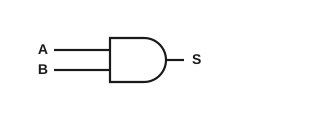

### Exercício 18 — OR de duas entradas

OR só vale 0 se todas as entradas forem 0.

a) Identifique a porta (curva = OR).
b) A=0 e B=0: calcule S.
c) Se A=0 e B=1, S valeria quanto?

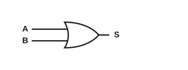

### Exercício 19 — Inversor

NOT inverte uma vez. S=A'.

a) Identifique o bloco (triângulo + bolha).
b) A=1: S vale quanto?
c) A=0: S valeria quanto?

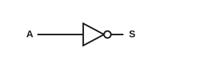

### Exercício 20 — NAND

NAND: primeiro AND, depois inverta.

a) Identifique o bloco (AND + bolha).
b) A=1 e B=1: calcule S em dois passos.
c) A=0 e B=0: S valeria quanto?

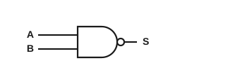

### Exercício 21 — NOR

NOR só vale 1 se todos forem 0.

a) Identifique o bloco (OR + bolha).
b) A=0 e B=0: calcule S em dois passos.
c) A=1 e B=0: S valeria quanto?

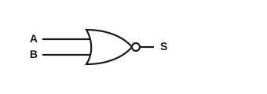

### Exercício 22 — XOR

⊕: 1 se diferentes, 0 se iguais.

a) Identifique o bloco (OR + traço extra).
b) A=1 e B=1: S vale quanto?
c) A=1 e B=0: S valeria quanto?

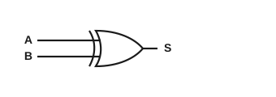

### Exercício 23 — XNOR

XNOR vale 1 quando as entradas são iguais.

a) Identifique o bloco (XOR + bolha).
b) A=0 e B=0: S vale quanto?
c) A=1 e B=0: S valeria quanto?

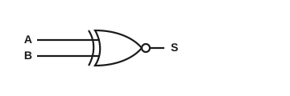

### Exercício 24 — AND + NOT

AND primeiro; NOT depois. Equivale a NAND.

a) Qual a ordem das portas?
b) A=1 e B=1: calcule S em dois passos.
c) Equivale a NAND. V ou F?

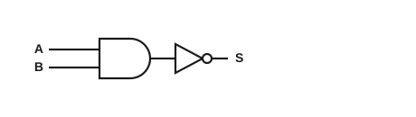

### Exercício 25 — OR depois AND

S=(A+B)·C. OR primeiro; AND com C depois.

a) Escreva a ordem.
b) A=0, B=1 e C=1: calcule os dois passos.
c) Se C fosse 0, S valeria quanto?

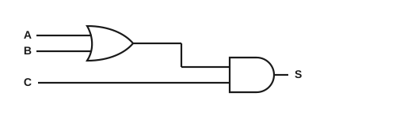

### Exercício 26 — NOT em A e AND com B

S=A'·B. Primeiro inverta A.

a) Escreva S.
b) A=0 e B=1: dois passos.
c) A=1 e B=1: S valeria quanto?

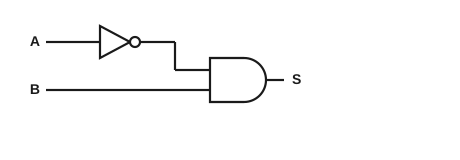

### Exercício 27 — Porta automática enxuta

S=(p+q)z'. z=1 → z'=0 → não abre.

a) Quais portas, na ordem?
b) p=1, q=0 e z=1: calcule (p+q), depois z', depois AND.
c) Se z fosse 0, S valeria quanto?

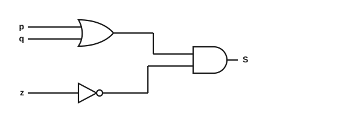

### Exercício 28 — Dois sensores (OR)

Bipe liga se pelo menos um sensor for 1.

a) Identifique a porta.
b) A=1 e B=1: S vale quanto? O bipe liga?
c) Por que não usar XOR neste caso?

### Exercício 29 — Duas permissões (AND)

As duas entradas precisam ser 1.

a) Identifique a porta.
b) A=1 e B=0: S vale quanto?
c) Por que um único 0 apaga S?

### Exercício 30 — NAND amarrada

NAND(A,A)=NOT. A=0 na entrada.

a) As duas entradas estão no mesmo fio. Qual porta equivalente?
b) A=0: S vale quanto?
c) A=1: S valeria quanto?

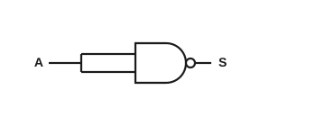

### Exercício 31 — XOR depois OR

Primeiro A⊕B; depois OR com C.

a) Qual a ordem?
b) A=1, B=1 e C=0: dois passos.
c) Se C fosse 1, S valeria quanto?

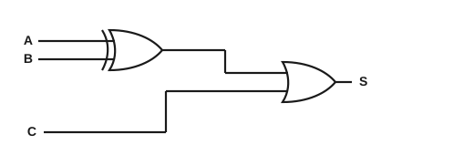

### Exercício 32 — Duas AND e OR

S=(A·B)+(C·D).

a) Escreva S.
b) A=1, B=1, C=0 e D=1: as duas AND, depois OR.
c) Se A fosse 0, com o resto igual, S valeria quanto?

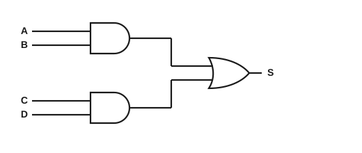

### Exercício 33 — Três portas e o atraso

S1 = A·B. S2 = S1+C. S = S2'. A=1, B=1, C=0. Cada porta atrasa 2 ns.

a) Calcule S1, S2 e S.
b) O caminho tem quantos nanossegundos?
c) Um 0 em B, com C=0 e A=1, mudaria S2 e S para quanto?

### Exercício 34 — XOR de cinco na saída da porta

⊕ vale 1 se os bits forem diferentes. Encadeie (((A⊕B)⊕C)⊕D)⊕E com os bits 1, 1, 0, 1, 0.

a) Escreva os quatro passos.
b) Quantos uns há na lista?
c) O final é 1 porque a quantidade de uns é ímpar? V ou F.
## Gabarito

**1)** a) AND de A e B; fio da AND na NOT; S na NOT.

b) NAND.
c) AND(1,1)=1; NOT 1 = 0. S=0.

**2)** a) OR de A e B com bolha em S.

b) NOR.
c) OR(0,0)=0; inverte → 1. S=1.

**3)** a) Duas AND (AB e CD) cujas saídas alimentam uma OR; S na OR.

b) S = (A·B)+(C·D).
c) (1·1)+(0·1)=1+0=1.

**4)** a) NOT em A; AND de A' com B; S na AND.

b) S = A'·B.
c) NOT 0 = 1; 1 AND 1 = 1. S=1.

**5)** a) NAND(A,A); as duas entradas no mesmo fio A.

b) NOT.
c) NAND(0,0)=1 = NOT 0.

**6)** a) XOR de A e B com bolha em S.

b) XNOR.
c) XOR(1,1)=0; bolha inverte → 1. S=1 (iguais).

**7)** a) OR de p e q; NOT em z; AND das duas saídas; S na AND.

b) S=(p+q)z'.
c) 1+0=1; NOT 1=0; 1·0=0. Não abre.

**8)** a) Uma AND de três entradas A, B e C; S na AND.

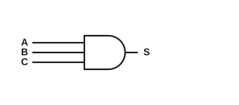

b) Três.
c) 1·1·0=0.

**9)** a) OR de A e B; AND dessa saída com C; S na AND.

b) S=(A+B)·C.
c) (0+1)·1=1.

**10)** a) Contorno da OR com bolha na saída (NOR).

b) NOR.
c) OR(1,0)=1; inverte → 0.

**11)** a) Duas NOT em série no fio A.

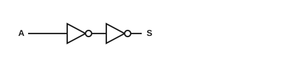

b) S = A (o bit volta).
c) NOT 1=0; NOT 0=1. S=1.

**12)** a) AND de A e B; OR com C; NOT no fim; S na NOT.

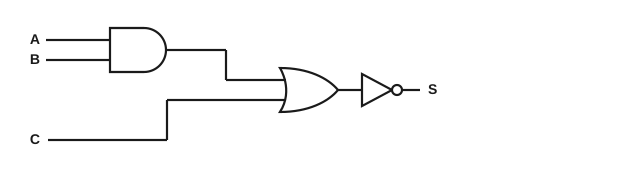

b) S = ((A·B)+C)'.
c) (1·1)+0=1; NOT 1=0. S=0.

**13)** a) XOR de A e B; AND dessa saída com C; S na AND.

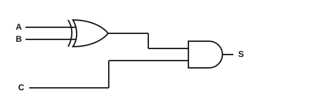

b) S=(A⊕B)·C.
c) (1⊕0)·1=1·1=1.

**14)** a) AND de En e A; S na AND.

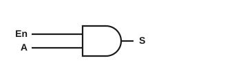

b) Bloqueia (S=0).
c) 0·1=0.

**15)** a) AND de A e B; AND de A e C; OR das duas; S na OR.

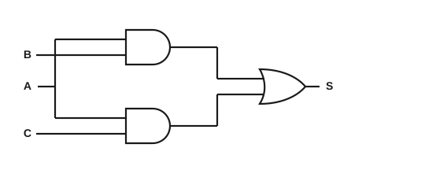

b) S = A·B + A·C.
c) (1·0)+(1·1)=0+1=1.

**16)** a) NOT em A e NOT em B; AND de A' e B'; S na AND.

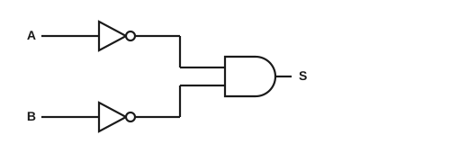

b) NOR (A'·B' = (A+B)').
c) NOT 1=0; NOT 1=0; 0 AND 0 = 0.

**17)** a) AND.
b) 1 AND 0 = 0.
c) 1.

**18)** a) OR.
b) 0 OR 0 = 0.
c) 1.

**19)** a) NOT.
b) NOT 1 = 0.
c) 1.

**20)** a) NAND.
b) AND(1,1)=1; inverte → 0.
c) 1.

**21)** a) NOR.
b) OR(0,0)=0; inverte → 1.
c) 0.

**22)** a) XOR.
b) Iguais → 0.
c) 1.

**23)** a) XNOR.
b) Iguais → 1.
c) 0.

**24)** a) AND e depois NOT.
b) AND(1,1)=1; NOT 1=0.
c) V.

**25)** a) OR de A e B; AND com C.
b) (0+1)=1; 1·1=1. S=1.
c) 0 (AND com 0).

**26)** a) S=A'·B.
b) NOT 0=1; 1 AND 1=1.
c) NOT 1=0; 0 AND 1=0.

**27)** a) OR de p,q; NOT de z; AND.
b) 1+0=1; NOT 1=0; 1·0=0. Não abre.
c) 1·1=1. Abriria.

**28)** a) OR.
b) 1 OR 1 = 1. Sim, liga.
c) XOR(1,1)=0 apagaria o bipe com os dois ativos.

**29)** a) AND.
b) 1 AND 0 = 0.
c) AND só é 1 se todos forem 1.

**30)** a) NOT.
b) NAND(0,0)=1.
c) NAND(1,1)=0.

**31)** a) XOR e depois OR.
b) 1⊕1=0; 0 OR 0=0.
c) 0 OR 1=1.

**32)** a) S=(A·B)+(C·D).
b) (1·1)+(0·1)=1+0=1.
c) (0·1)+(0·1)=0.

**33)** a) S1=1. S2=1. S=0.
b) 6 ns.
c) S1=0. S2=0. S=1.

**34)** a) 1⊕1=0. 0⊕0=0. 0⊕1=1. 1⊕0=1.
b) Três.
c) V.
