# UN4 S3 — Lista geral B (com diagramas)

Símbolos: AND entrada reta; OR entrada curva; NOT triângulo com bolha; XOR = OR com traço extra. Entradas à esquerda, saída à direita.
Em a/b/c, responda o que o item pede. Bolha no pino = inversão naquele ponto.

## Desenhar o circuito

Monte no caderno (símbolos padronizados). O gabarito no fim traz o diagrama montado.

### Exercício 1 — OR seguida de NOT

Monte com os símbolos do cabeçalho (AND reta, OR curva, NOT com bolha).

a) Desenhe: A e B entram numa OR; a saída da OR entra numa NOT; S é a saída da NOT.
b) Equivale a qual porta de um bloco só?
c) A=0 e B=1: primeiro OR; depois NOT.

### Exercício 2 — OR de três entradas

OR de vários bits só vale 0 se todos forem 0.

a) Desenhe: A, B e C entram numa OR de três entradas; S é a saída.
b) Quantas entradas?
c) A=B=1 e C=0: S vale quanto?

### Exercício 3 — XOR

XOR: OR com traço extra. 1 se as entradas diferem.

a) Desenhe: A e B entram numa XOR (OR com traço extra na entrada); S é a saída.
b) Na linha 11 (A=1 e B=1), XOR vale 0 ou 1?
c) A=0 e B=1: S vale quanto?

### Exercício 4 — Porta automática longa

S = q·z' + q'·p·z'. Inclua NOT de z e de q. S=1 abre.

a) Desenhe: AND de q e z'; AND de p, q' e z'; as duas AND entram numa OR. Inclua os NOT de z e de q.
b) Quais tipos de porta entram?
c) p=0, q=1 e z=0: calcule cada AND e a OR.

### Exercício 5 — NOT em A e B, depois OR

A'+B' = (A·B)' (De Morgan).

a) Desenhe: A entra num NOT; B entra noutro NOT; os dois NOT entram numa OR; S é a saída da OR.
b) S equivale a qual porta de A e B?
c) A=1 e B=1: S vale quanto?

### Exercício 6 — NAND depois OR

NAND primeiro (AND e inverta); depois OR com C.

a) Desenhe: A e B entram numa NAND; a saída da NAND e C entram numa OR; S é a saída da OR.
b) Escreva a ordem.
c) A=1, B=1 e C=0: dois passos.

### Exercício 7 — Duas OR e uma AND

Monte com os símbolos do cabeçalho (AND reta, OR curva, NOT com bolha).

a) Desenhe: A e B entram numa OR; C e D entram noutra OR; as duas saídas entram numa AND; S é a saída da AND.
b) Escreva S.
c) A=B=0, C=1, D=0: as duas OR, depois AND.

### Exercício 8 — OR de quatro entradas

Basta um 1 para S=1.

a) Desenhe: A, B, C e D entram numa OR de quatro entradas; S é a saída.
b) Quantas entradas?
c) A=B=C=0 e D=1: S vale quanto?

### Exercício 9 — NOT, AND e OR

Monte com os símbolos do cabeçalho (AND reta, OR curva, NOT com bolha).

a) Desenhe: A entra num NOT; a saída do NOT entra numa AND com B; a saída da AND entra numa OR com C; S é a saída da OR.
b) Escreva S.
c) A=1, B=1 e C=0: NOT, AND, OR.

### Exercício 10 — AND com bolha (NAND)

Bolha na saída da AND = NAND.

a) Desenhe: A e B entram numa AND; coloque bolha na saída; S é esse pino.
b) Qual o nome do bloco?
c) A=0 e B=1: S vale quanto?

### Exercício 11 — XNOR

XNOR: XOR com bolha. 1 se iguais.

a) Desenhe: A e B entram numa XNOR (XOR com bolha na saída).
b) Eq=1 significa o quê?
c) A=1 e B=0: S vale quanto?

### Exercício 12 — Dois sensores no bipe

OR: qualquer 1 liga o bipe.

a) Desenhe: Dois fins de curso A e B entram numa OR; S vai ao bipe.
b) A=0 e B=1: o bipe liga?
c) Por que OR e não XOR?

### Exercício 13 — Duas permissões

AND: as duas precisam ser 1.

a) Desenhe: Prensa bimanual: botões A e B entram numa AND; S comanda o solenóide.
b) A=1 e B=0: S vale quanto?
c) Por que uma mão só não desce a prensa?

### Exercício 14 — Botão ativo em 0 e sirene

Botão pressionado puxa A a 0. Sirene liga em S=1. NOT no meio.

a) Desenhe: A entra num NOT; a sirene liga em S=1. Marque o botão em A e a sirene em S.
b) A=0 (pressionado): a sirene toca?
c) A=1 (solto): toca?

### Exercício 15 — AND depois NAND

AND de A e B; esse resultado entra numa NAND com C.

a) Desenhe: A e B entram numa AND; a saída da AND entra numa NAND com C; S é a saída da NAND.
b) Escreva a ordem.
c) A=B=C=1: AND, depois NAND.

### Exercício 16 — NOR depois NOT

NOR e depois NOT devolve a OR: ((A+B)')' = A+B.

a) Desenhe: A e B entram numa NOR; a saída da NOR entra num NOT; S é a saída do NOT.
b) Equivale a qual porta?
c) A=0 e B=0: dois passos.

## Ler o circuito (qual é S?)

O diagrama já está montado. Calcule da esquerda para a direita.

### Exercício 17 — OR + NOT

OR primeiro; NOT depois. Equivale a NOR.

a) Qual a ordem?
b) A=0 e B=1: dois passos.
c) Equivale a NOR. V ou F?

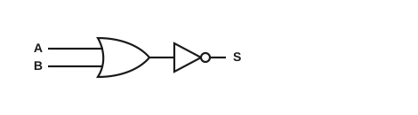

### Exercício 18 — AND de três

AND só vale 1 se todos forem 1.

a) Quantas entradas?
b) A=1, B=1 e C=0: S vale quanto?
c) A=B=C=1: S valeria quanto?

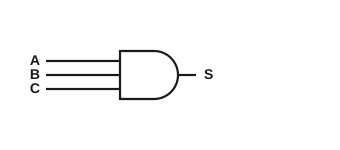

### Exercício 19 — XOR

1 se diferentes.

a) Identifique o bloco.
b) A=0 e B=1: S vale quanto?
c) A=1 e B=1: S valeria quanto?

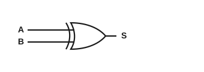

### Exercício 20 — Dois NOT e AND

S=A'·B'.

a) Escreva S.
b) A=1 e B=1: inverta os dois; depois AND.
c) Equivale a NOR. V ou F?

### Exercício 21 — NAND depois OR

NAND(A,B) depois OR com C.

a) Qual a ordem?
b) A=1, B=1 e C=0: dois passos.
c) Se C fosse 1, S valeria quanto?

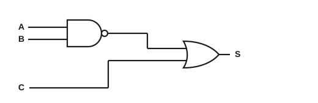

### Exercício 22 — Duas OR e AND

S=(A+B)·(C+D).

a) Escreva S.
b) A=0, B=0, C=1 e D=0: duas OR, depois AND.
c) Se A fosse 1, S valeria quanto?

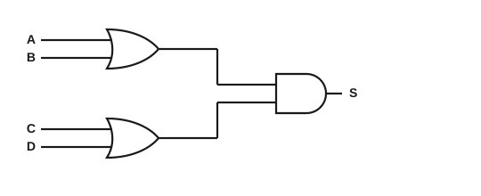

### Exercício 23 — OR de quatro

Basta um 1.

a) Quantas entradas?
b) A=B=C=0 e D=1: S vale quanto?
c) Todas 0: S valeria quanto?

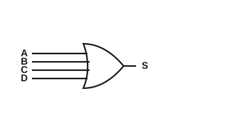

### Exercício 24 — NOT-AND-OR

S=A'·B+C.

a) Escreva S.
b) A=1, B=1 e C=0: três passos.
c) Se C fosse 1, S valeria quanto?

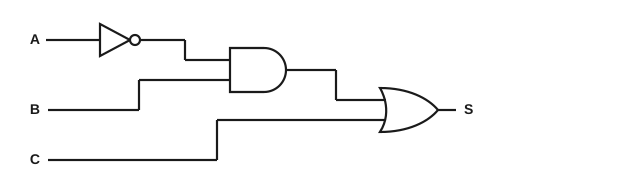

### Exercício 25 — NAND

Primeiro AND; depois inverta.

a) Identifique o bloco.
b) A=0 e B=1: dois passos.
c) Só a linha 11 (A=B=1) dá S=0. V ou F?

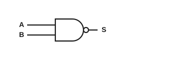

### Exercício 26 — XNOR

1 se iguais.

a) Identifique o bloco.
b) A=1 e B=0: S vale quanto?
c) A=1 e B=1: S valeria quanto?

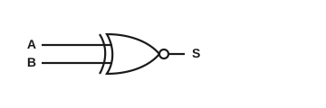

### Exercício 27 — Porta automática longa

S=q·z'+q'·p·z'.

a) Calcule com p=0, q=1 e z=0 cada AND.
b) A OR final vale quanto? Abre?
c) Se z fosse 1, S valeria quanto?

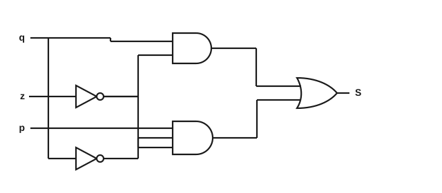

### Exercício 28 — NOR + NOT

((A+B)')'=A+B.

a) Qual a ordem?
b) A=0 e B=0: dois passos.
c) Equivale a OR. V ou F?

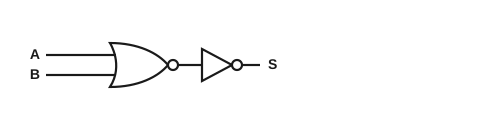

### Exercício 29 — AND + NAND

AND(A,B) entra na NAND com C.

a) Qual a ordem?
b) A=B=C=1: dois passos.
c) Se C fosse 0, S valeria quanto?

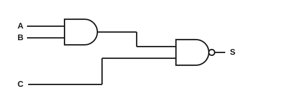

### Exercício 30 — Sirene e NOT

A=0 pressionado. Sirene liga em S=1.

a) A=0: S vale quanto?
b) A sirene toca?
c) A=1 (solto): toca?

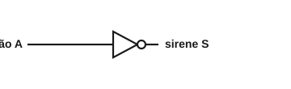

### Exercício 31 — Porta enxuta, ninguém

S=(p+q)z'. p=q=z=0.

a) Calcule (p+q) e z'.
b) S vale quanto? Abre?
c) Falta pessoa e falta abrir. V ou F?

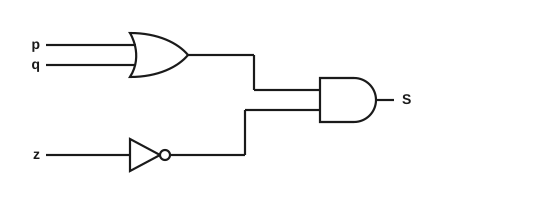

### Exercício 32 — XOR e AND

S=(A⊕B)·C.

a) Escreva S.
b) A=1, B=0 e C=1: XOR, depois AND.
c) Se C fosse 0, S valeria quanto?

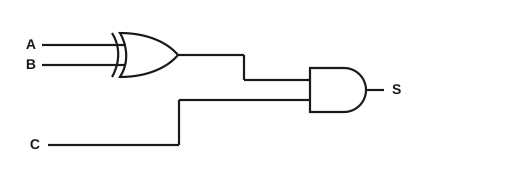

### Exercício 33 — NAND de quatro e NOR de quatro

a) NAND(1,1,1,0): primeiro o AND, depois o NOT.
b) NOR(0,0,1,0): primeiro o OR, depois o NOT.
c) NAND(1,1,1,1) e NOR(0,0,0,0).

### Exercício 34 — Porta automática, dois jeitos

Forma enxuta: S=(p+q)·z'. Forma longa: S=q·z'+q'·p·z'. p=0, q=1, z=0.

a) Calcule a forma enxuta.
b) Calcule a forma longa, termo a termo.
c) Os dois resultados coincidem?
## Gabarito

**1)** a) OR de A e B; fio na NOT; S na NOT.

b) NOR.
c) 0+1=1; NOT 1=0. S=0.

**2)** a) Uma OR de três entradas A, B e C; S na OR.

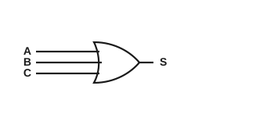

b) Três.
c) 1+1+0=1.

**3)** a) XOR de A e B (contorno da OR com traço extra); S na XOR.

b) 0.
c) Diferentes → 1.

**4)** a) NOT em z e NOT em q; AND de q e z'; AND de p, q' e z'; OR das duas AND; S na OR.

b) AND, OR e NOT.
c) q·z'=1·1=1; q'·p·z'=0·0·1=0; OR=1. Abre.

**5)** a) NOT em A e NOT em B; OR de A' e B'; S na OR.

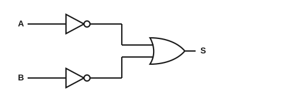

b) NAND (A'+B'=(A·B)').
c) 0+0=0.

**6)** a) NAND de A e B; OR dessa saída com C; S na OR.

b) NAND, depois OR.
c) NAND(1,1)=0; 0 OR 0=0.

**7)** a) OR de A e B; OR de C e D; AND das duas; S na AND.

b) S=(A+B)·(C+D).
c) (0+0)·(1+0)=0·1=0.

**8)** a) Uma OR de quatro entradas A, B, C e D; S na OR.

b) Quatro.
c) 0+0+0+1=1.

**9)** a) NOT em A; AND de A' com B; OR dessa saída com C; S na OR.

b) S = A'·B + C.
c) NOT 1=0; 0·1=0; 0+0=0.

**10)** a) AND de A e B com bolha em S.

b) NAND.
c) AND(0,1)=0; inverte → 1.

**11)** a) XOR de A e B com bolha na saída (XNOR).

b) A e B iguais.
c) Diferentes → 0.

**12)** a) OR de A e B; S no bipe.

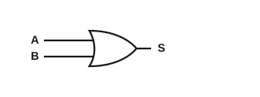

b) Sim (0+1=1).
c) XOR(1,1)=0 apagaria com os dois em 1.

**13)** a) AND de A e B; S no solenóide.

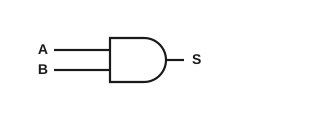

b) 0.
c) AND exige os dois pinos em 1.

**14)** a) Botão em A; NOT no meio; sirene em S.

b) Sim. NOT 0 = 1.
c) Não. NOT 1 = 0.

**15)** a) AND de A e B; NAND dessa saída com C; S na NAND.

b) AND, depois NAND.
c) AND(1,1)=1; NAND(1,1)=0.

**16)** a) NOR de A e B; NOT na saída da NOR; S no NOT.

b) OR.
c) NOR(0,0)=1; NOT 1=0. S=0 (= 0 OR 0).

**17)** a) OR e depois NOT.
b) 0+1=1; NOT 1=0.
c) V.

**18)** a) Três.
b) 1·1·0=0.
c) 1.

**19)** a) XOR.
b) Diferentes → 1.
c) 0.

**20)** a) S=A'·B'.
b) 0 AND 0 = 0.
c) V.

**21)** a) NAND, depois OR.
b) NAND(1,1)=0; 0+0=0.
c) 1.

**22)** a) S=(A+B)·(C+D).
b) (0+0)·(1+0)=0.
c) 1·1=1.

**23)** a) Quatro.
b) 1.
c) 0.

**24)** a) S=A'·B+C.
b) NOT 1=0; 0·1=0; 0+0=0.
c) 1.

**25)** a) NAND.
b) AND(0,1)=0; inverte → 1.
c) V.

**26)** a) XNOR.
b) Diferentes → 0.
c) 1.

**27)** a) q·z'=1·1=1; q'·p·z'=0·0·1=0.
b) 1+0=1. Sim, abre.
c) z'=0 zera as duas AND → 0.

**28)** a) NOR e depois NOT.
b) NOR(0,0)=1; NOT 1=0.
c) V.

**29)** a) AND, depois NAND.
b) AND=1; NAND(1,1)=0.
c) NAND(1,0)=1.

**30)** a) NOT 0 = 1.
b) Sim, toca.
c) Não (NOT 1=0).

**31)** a) 0+0=0; NOT 0=1.
b) 0·1=0. Não abre.
c) V.

**32)** a) S=(A⊕B)·C.
b) (1⊕0)·1=1.
c) 0.

**33)** a) AND=0, NAND=1.
b) OR=1, NOR=0.
c) NAND=0. NOR=1.

**34)** a) (0+1)·1=1.
b) q·z'=1. q'·p·z'=0. S=1+0=1.
c) Sim.
