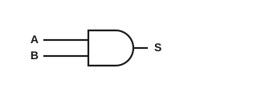
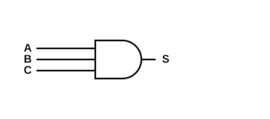
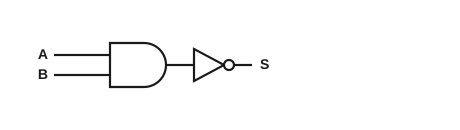

# UN4 S3 — Porta AND

Símbolos: AND entrada reta; OR entrada curva; NOT triângulo com bolha; XOR = OR com traço extra. Entradas à esquerda, saída à direita.
Em a/b/c, responda o que o item pede. Bolha no pino = inversão naquele ponto.

### Exercício 1 — Símbolo

A AND só coloca S em 1 quando TODAS as entradas estão em 1. Contorno: entrada reta.

a) No símbolo padronizado da AND, a lateral de entrada é reta ou curva?
b) Desenhe o símbolo da AND de duas entradas e marque A, B e S.
c) Símbolo com entrada curva e saída pontiaguda: é AND ou OR?

### Exercício 2 — Chip select como AND

O chip só é selecionado se a linha A está em 1 E a linha B está em 1. CS = A · B. AND só vale 1 se todos forem 1.

a) Identifique a porta pelo contorno.
b) A=1 e B=0: CS vale quanto? O chip é selecionado?
c) A=1 e B=1: CS vale quanto?

### Exercício 3 — Três entradas

AND de vários bits só vale 1 se todos forem 1.

a) Quantas entradas tem este bloco?
b) A=1, B=1 e C=0. Calcule S. (Um 0 já decide.)
c) AND de quatro entradas, todas em 1. S vale quanto?

### Exercício 4 — AND + bolha

Bolha na saída da AND inverte o pino S. O bloco passa a se chamar NAND.

a) A saída de uma AND entra num NOT. Isso equivale a qual porta de um bloco só?
b) A=1 e B=1 neste diagrama: primeiro a AND, depois a NOT. S vale quanto?
c) Por que um único 0 em qualquer entrada da AND apaga S?

### Exercício 5 — AND de quatro entradas

AND de vários bits vale 1 só se todos forem 1.

a) A=1, B=1, C=1, D=0. S vale quanto?
b) D passa a 1. S vale quanto?
c) As quatro entradas estão em 1 e há uma bolha na saída. A saída vale quanto?

### Exercício 6 — Duas AND em cascata

S1 = A·B. S = S1·C·D. A=1, B=0, C=1, D=1.

a) Calcule S1.
b) Calcule S.
c) O 0 de B aparece em S?
## Gabarito

**1)** a) Reta.
b) Contorno com entrada reta; A e B à esquerda; S à direita.
c) OR.

**2)** a) AND (entrada reta).
b) 1 AND 0 = 0. Não: o chip não é selecionado.
c) 1 AND 1 = 1.

**3)** a) Três (A, B e C).
b) 1·1·0 = 0.
c) 1.

**4)** a) NAND.
b) AND(1,1)=1; NOT 1 = 0. S=0.
c) AND só é 1 se todos os pinos forem 1. Um 0 zera o produto.

**5)** a) 0.
b) 1.
c) 0. A bolha inverte o 1 da AND: vira NAND.

**6)** a) 0.
b) 0. 0·1·1=0.
c) Sim. O 0 atravessa as duas portas.
