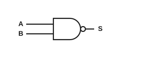
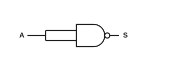

# UN4 S3 — Porta NAND

Símbolos: AND entrada reta; OR entrada curva; NOT triângulo com bolha; XOR = OR com traço extra. Entradas à esquerda, saída à direita.
Em a/b/c, responda o que o item pede. Bolha no pino = inversão naquele ponto.

### Exercício 1 — Símbolo

NAND é AND com a saída invertida: S = (A·B)'. Contorno da AND com bolha em S.

a) A bolha fica em qual pino? O contorno é o da AND ou o da OR?
b) Desenhe o símbolo da NAND e marque a bolha.
c) Se tirar a bolha deste símbolo, o bloco vira qual porta?

### Exercício 2 — Calcule S

AND primeiro, depois inverta.

a) A=1 e B=1. Primeiro AND(1,1); depois inverta. S vale quanto?
b) A=0 e B=0. S vale quanto?
c) Complete as quatro saídas na ordem 00, 01, 10, 11.

### Exercício 3 — NAND(A,A) = NOT

a) Como obter um NOT com uma NAND?
b) Calcule NAND(0,0) e NAND(1,1). Compare com NOT 0 e NOT 1.
c) Por que a NAND é chamada universal? (uma frase)

### Exercício 4 — Três entradas

NAND de n bits só vale 0 se TODAS as entradas forem 1.

a) NAND de três entradas, todas em 1. S vale quanto?
b) NAND de três entradas, uma delas em 0. S vale quanto?
c) (A·B)' = A'+B' descreve o pino S da NAND. V ou F?

### Exercício 5 — NAND de quatro pinos

Primeiro o AND, depois a bolha da saída.

a) Entradas 1, 1, 1, 0. AND interno e NAND.
b) Entradas 1, 1, 1, 1. AND interno e NAND.
c) Entradas 0, 0, 0, 0. NAND vale 0?

### Exercício 6 — NAND seguida de NOT

A NAND já tem bolha na saída. Um NOT depois dessa saída inverte de novo.

a) A=1, B=0. Calcule a NAND.
b) Inverta essa saída.
c) O resultado do item b é o mesmo que AND(1,0)?
## Gabarito

**1)** a) Na saída; contorno da AND (entrada reta).
b) AND com bolha na saída; A e B à esquerda; S à direita.
c) AND.

**2)** a) AND(1,1)=1; NAND inverte → 0.
b) AND(0,0)=0; inverte → 1.
c) 1, 1, 1, 0.

**3)** a) Amarrar as duas entradas no mesmo A.
b) NAND(0,0)=1 = NOT 0. NAND(1,1)=0 = NOT 1.
c) Só ela monta qualquer função (universal).

**4)** a) 0.
b) 1. Basta um 0 para a NAND valer 1.
c) V (De Morgan).

**5)** a) AND=0. NAND=1.
b) AND=1. NAND=0.
c) Não. AND interno=0, NAND=1.

**6)** a) NOT(1·0)=1.
b) 0.
c) Sim. AND(1,0)=0. A segunda inversão desfaz a bolha.
