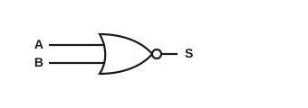

# UN4 S3 — Porta NOR

Símbolos: AND entrada reta; OR entrada curva; NOT triângulo com bolha; XOR = OR com traço extra. Entradas à esquerda, saída à direita.
Em a/b/c, responda o que o item pede. Bolha no pino = inversão naquele ponto.

### Exercício 1 — Símbolo

NOR é OR com a saída invertida: S = (A+B)'. Contorno da OR com bolha em S.

a) O contorno da NOR é o da OR (entrada curva) ou o da AND (entrada reta)?
b) A bolha fica em qual pino?
c) Se tirar a bolha, o bloco vira qual porta?

### Exercício 2 — Calcule S

OR primeiro, depois inverta. NOR só vale 1 se todos forem 0.

a) A=0 e B=0. Primeiro OR(0,0); depois inverta. S vale quanto? É a única combinação que vale 1?
b) A=1 e B=0. S vale quanto?
c) Complete as quatro saídas na ordem 00, 01, 10, 11.

### Exercício 3 — NOR(A,A) = NOT

a) NOR(A,A) equivale a NOT. Confira com A=0 e com A=1.
b) A NOR também é universal. V ou F?
c) Uma OR cuja saída entra num NOT equivale a uma NOR. V ou F?

### Exercício 4 — Três linhas ociosas

Idle só acende se CPU, DMA e um terceiro pedido estão em 0. Idle = NOR(C, D, E).

a) NOR de três entradas, todas em 0. S vale quanto?
b) Um dos três vale 1 e os outros 0. S vale quanto? (NOR só é 1 se todos forem 0.)
c) (A+B)' = A'·B' descreve o pino S da NOR. V ou F?

### Exercício 5 — NOR de quatro pinos

Primeiro a OR, depois a bolha da saída.

a) Entradas 0, 0, 0, 1. OR interna e NOR.
b) Entradas 0, 0, 0, 0. OR interna e NOR.
c) Entradas 1, 1, 1, 1. NOR vale 1?

### Exercício 6 — NOR seguida de NOT

a) A=0, B=1. Calcule a NOR.
b) Inverta essa saída.
c) O resultado do item b é o mesmo que OR(0,1)?
## Gabarito

**1)** a) OR (entrada curva).
b) Na saída.
c) OR.

**2)** a) OR(0,0)=0; inverte → 1. Sim: só a linha 00 vale 1.
b) OR(1,0)=1; inverte → 0.
c) 1, 0, 0, 0.

**3)** a) NOR(0,0)=1 = NOT 0. NOR(1,1)=0 = NOT 1.
b) V.
c) V.

**4)** a) 1 (barramento ocioso).
b) 0. Basta um 1 para a NOR cair a 0.
c) V (De Morgan).

**5)** a) OR=1. NOR=0.
b) OR=0. NOR=1.
c) Não. OR=1, NOR=0.

**6)** a) NOT(0+1)=0.
b) 1.
c) Sim. OR(0,1)=1. A segunda inversão desfaz a bolha.
