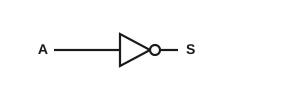
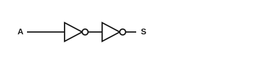
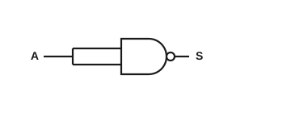

# UN4 S3 — Inversor (NOT)

Símbolos: AND entrada reta; OR entrada curva; NOT triângulo com bolha; XOR = OR com traço extra. Entradas à esquerda, saída à direita.
Em a/b/c, responda o que o item pede. Bolha no pino = inversão naquele ponto.

### Exercício 1 — Símbolo

O inversor tem uma entrada e uma saída S = A'. Símbolo: triângulo com bolha no bico.

a) Desenhe o símbolo padronizado do inversor e indique onde está a bolha.
b) Quantos pinos de entrada tem o NOT? Quantos de saída?
c) Um triângulo sem bolha ainda inverte? V ou F?

### Exercício 2 — Reset ativo em 0

O pino nRST pede reset quando vale 0 (ativo em baixo). O software converte: RST = nRST' (RST=1 significa “há pedido de reset”).

a) nRST=0 entra neste NOT. RST (S) vale quanto? Há pedido de reset?
b) nRST=1. RST vale quanto?
c) Por que um pino que entrega 0 quando ativo precisa de NOT antes de uma lógica que liga em 1?

### Exercício 3 — Duas NOT em série

Duas inversões seguidas se cancelam: (A')' = A.

a) Duas NOT em série no mesmo fio. O bit no fim é o original ou o invertido?
b) A=0 na primeira entrada. Calcule da esquerda para a direita até S.
c) A tabela do NOT tem quatro linhas. V ou F?

### Exercício 4 — NOT com NAND amarrada

Ligue as duas entradas da NAND no mesmo bit A. NAND(A,A) vira NOT.

a) Como obter um NOT amarrando os pinos de uma NAND?
b) Com A=0 neste diagrama, S vale quanto? Compare com NOT 0.
c) O inversor pode ter duas entradas independentes A e B. V ou F?

### Exercício 5 — Três inversores em série

A=1 entra no primeiro NOT. A saída dele entra no segundo. A saída do segundo entra no terceiro.

a) Saída do primeiro.
b) Saída do segundo.
c) Saída do terceiro.

### Exercício 6 — Quatro fios, cada um num NOT

a) A=1, B=0, C=1, D=0. Escreva as quatro saídas.
b) Cada uma dessas saídas entra em outro NOT. Quais são os quatro bits finais?
c) Dois NOT em série devolvem o bit que entrou. V ou F.
## Gabarito

**1)** a) Triângulo com bolha no bico (saída).
b) Uma entrada, uma saída.
c) F. A bolha é a inversão no símbolo padrão.

**2)** a) NOT 0 = 1. Sim: nRST=0 é o pedido; o software vê RST=1.
b) NOT 1 = 0.
c) Porque 0 no pino precisa virar 1 na lógica que “liga” em 1.

**3)** a) O original (A'' = A).
b) NOT 0 = 1; NOT 1 = 0. S=0 (volta ao A).
c) F. Duas linhas (A=0 e A=1).

**4)** a) As duas entradas no mesmo fio A.
b) NAND(0,0)=1 = NOT 0.
c) F. O NOT tem uma entrada.

**5)** a) 0.
b) 1.
c) 0. Três NOT deixam o inverso de A.

**6)** a) 0, 1, 0, 1.
b) 1, 0, 1, 0.
c) V.
