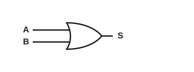
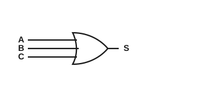

# UN4 S3 — Porta OR

Símbolos: AND entrada reta; OR entrada curva; NOT triângulo com bolha; XOR = OR com traço extra. Entradas à esquerda, saída à direita.
Em a/b/c, responda o que o item pede. Bolha no pino = inversão naquele ponto.

### Exercício 1 — Símbolo

A OR coloca S em 1 se PELO MENOS uma entrada estiver em 1. Contorno: entrada curva.

a) No símbolo padronizado da OR, a lateral de entrada é curva ou reta?
b) Desenhe o símbolo da OR de duas entradas e marque A, B e S.
c) Se acrescentar um traço extra na entrada do símbolo da OR, o bloco vira qual porta?

### Exercício 2 — Pedido no barramento

O barramento fica ocupado se a CPU pede (C=1) OU o DMA pede (D=1). Busy = C + D. OR de vários bits só vale 0 se todos forem 0.

a) Identifique a porta pelo contorno.
b) C=0 e D=1: Busy vale quanto? O barramento está ocupado?
c) C=1 e D=1: Busy vale 2? Qual valor correto e por quê?

### Exercício 3 — Três pedidos

a) Três linhas entram nesta OR; só a terceira está em 1. S vale quanto?
b) Todas as entradas em 0. S vale quanto?
c) Uma bolha na saída deste símbolo: o bloco passa a se chamar como?

### Exercício 4 — OR versus XOR

Na linha A=1 e B=1 a OR vale 1 e a XOR vale 0.

a) Dois sensores em 1 devem ligar o bipe. Usa-se OR ou XOR? Por quê?
b) A saída de uma OR entra em outra OR junto com C. A saída final ainda é “pelo menos um”?
c) Na combinação 11, a OR acende S. V ou F?

### Exercício 5 — OR de cinco entradas

OR vale 0 só se todas as entradas valem 0. 1+1=1.

a) Entradas 0, 0, 1, 0, 0. S vale quanto?
b) Entradas 1, 1, 1, 0. S vale quanto? Vale 3?
c) Algum 0, sozinho, zera uma OR?

### Exercício 6 — Duas OR em cascata

S1 = A+B. S = S1+C+D. A=0, B=0, C=0, D=1.

a) Calcule S1.
b) Calcule S.
c) Os três zeros dos itens a e b apagam D?
## Gabarito

**1)** a) Curva.
b) Contorno com entrada curva; A e B à esquerda; S à direita.
c) XOR.

**2)** a) OR (entrada curva).
b) 0 OR 1 = 1. Sim, ocupado.
c) Não vale 2. Na OR, 1+1=1 (não é soma aritmética; não há “vai um”).

**3)** a) 1. Basta um 1.
b) 0. OR de zeros continua 0.
c) NOR.

**4)** a) OR. XOR na linha 1,1 daria 0 e o bipe apagaria com os dois sensores ativos.
b) Sim (é OR de três, no fundo).
c) V.

**5)** a) 1.
b) 1. Não vale 3.
c) Não. A OR só fica 0 se todas as entradas forem 0.

**6)** a) 0.
b) 1. 0+0+1=1.
c) Não. D=1 acende a segunda OR.
