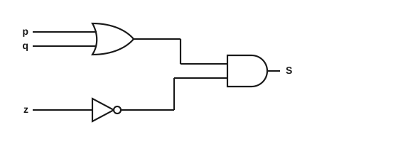
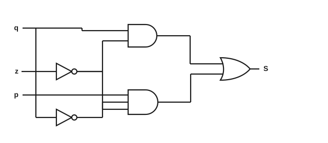

# UN4 S3 — Porta automática

Símbolos: AND entrada reta; OR entrada curva; NOT triângulo com bolha; XOR = OR com traço extra. Entradas à esquerda, saída à direita.
Em a/b/c, responda o que o item pede. Bolha no pino = inversão naquele ponto.

### Exercício 1 — Regra

S=1 significa: a porta abre. p=1: pessoa detectada. q=1: chave de abrir. z=1: chave de fechar.
Regra: abre se (q=1 e z=0) ou (q=0 e p=1 e z=0).
Forma longa: S = q·z' + q'·p·z'. Forma enxuta: S = (p+q)·z'.

a) Com p=1, q=0 e z=0, a porta abre? Calcule a forma enxuta: primeiro (p+q), depois AND com z'.
b) Com os mesmos p e q, mas z=1, a porta abre?
c) Com q=1, z=0 e p=0, a porta abre?

### Exercício 2 — Forma enxuta no diagrama

p e q entram numa OR; z entra num NOT; a OR e o NOT entram numa AND; S é a saída da AND.

a) Identifique a ordem: primeiro a OR de p e q e o NOT de z; depois a AND.
b) p=1, q=0 e z=1. Calcule S nesses dois passos.
c) p=0, q=0 e z=0. S vale quanto? A porta abre?

### Exercício 3 — Forma longa

AND de q e z'; AND de p, q' e z'; as duas AND entram numa OR. Inclua os NOT de z e de q.

a) Desenhe (ou confira) esse circuito. Quais tipos de porta entram (AND, OR, NOT)?
b) p=0, q=1 e z=0. Calcule cada AND e depois a OR.
c) A forma longa e a enxuta devem coincidir nas 8 linhas da tabela. V ou F?

### Exercício 4 — Por que z impede

z'=0 zera os produtos. AND de vários bits só vale 1 se todos forem 1.

a) Por que z=1 impede os dois caminhos de abrir?
b) Mostre em uma linha por que q + q'p vira q+p (absorção, A=q).
c) Esse circuito é combinacional (só entradas atuais) ou precisa lembrar o ciclo anterior?

### Exercício 5 — A forma enxuta com mais casos

S = (p+q)·z'. A porta abre quando S=1. Faça a soma primeiro e depois o AND com z'.

a) p=1, q=1, z=0. S vale quanto?
b) p=1, q=1, z=1. S vale quanto?
c) p=0, q=0, z=0. S vale quanto?

### Exercício 6 — Forma longa e forma enxuta

Forma longa: S = q·z' + q'·p·z'. Forma enxuta: S = (p+q)·z'.

a) p=1, q=0, z=0. Calcule a forma longa, termo a termo.
b) Com os mesmos bits, calcule a forma enxuta.
c) Os dois resultados coincidem?
## Gabarito

**1)** a) (1+0)·1 = 1·1 = 1. Sim, abre.
b) (1+0)·0 = 0. Não (z=1 fecha).
c) (0+1)·1 = 1. Sim (chave de abrir, z=0).

**2)** a) OR e NOT primeiro; AND por último. S=(p+q)z'.
b) Passo 1: 1 OR 0 = 1; NOT 1 = 0. Passo 2: 1 AND 0 = 0. S=0.
c) (0+0)·1 = 0. Não abre.

**3)** a) AND, OR e NOT.
b) q·z' = 1·1 = 1. q'·p·z' = 0·0·1 = 0. OR = 1. Abre.
c) V.

**4)** a) z=1 → z'=0. Um fator 0 zera cada AND.
b) A + A'B = A+B com A=q: q + q'p = q+p.
c) Combinacional: S depende só de p, q e z agora.

**5)** a) (1+1)·1=1. Abre.
b) (1+1)·0=0. Não abre. z=1 fecha.
c) (0+0)·1=0. Não abre. Não há pessoa nem chave.

**6)** a) q·z'=0. q'·p·z'=1·1·1=1. S=0+1=1.
b) (1+0)·1=1.
c) Sim. Os dois valem 1.
