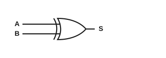
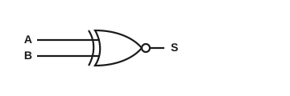

# UN4 S3 — Portas XOR e XNOR

Símbolos: AND entrada reta; OR entrada curva; NOT triângulo com bolha; XOR = OR com traço extra. Entradas à esquerda, saída à direita.
Em a/b/c, responda o que o item pede. Bolha no pino = inversão naquele ponto.

### Exercício 1 — Símbolos

XOR: S=1 quando as entradas diferem (ímpar de uns). Símbolo: OR com traço extra na entrada.
XNOR: S=1 quando as entradas são iguais. Símbolo: XOR com bolha na saída.

a) O traço extra na entrada muda qual linha em relação à OR? (linha 11 = A=1 e B=1)
b) XOR com bolha na saída: qual o nome do bloco?
c) Desenhe o símbolo da XOR e indique o traço extra.

### Exercício 2 — Calcule

O símbolo ⊕ é XOR: 1 se as entradas forem diferentes, 0 se forem iguais.

a) A=1 e B=1: quanto valem XOR, XNOR e OR?
b) A=1 e B=0: quanto valem XOR e XNOR?
c) Complete XOR na ordem 00, 01, 10, 11. Depois a XNOR.

### Exercício 3 — Paridade e igualdade

Paridade ímpar de dois bits: P = A ⊕ B. Igualdade: Eq = XNOR(A, B).

a) Bit de paridade ímpar: XOR ou XNOR?
b) Para comparar igualdade de dois flags, XOR ou XNOR?
c) Calcule a paridade dos bits 1, 0 e 1 em dois passos. Primeiro: 1 ⊕ 0. Depois: o resultado ⊕ 1.

### Exercício 4 — XOR(A,A)

a) XOR(A,A) vale sempre quanto?
b) Na combinação 11, OR e XOR têm o mesmo S. V ou F?
c) Dois pedidos no barramento devem ocupar também quando os dois estão em 1. XOR, XNOR ou OR?

### Exercício 5 — XOR de cinco entradas

⊕ vale 1 quando os dois bits são diferentes. Encadeie da esquerda para a direita: (((A⊕B)⊕C)⊕D)⊕E.

a) Bits 1, 0, 1, 1, 0. Escreva os quatro passos e o final.
b) Quantos uns há nessa lista?
c) O final confere com “quantidade ímpar de uns”?

### Exercício 6 — XNOR não testa os três de uma vez

⊙ vale 1 quando os dois bits são iguais.

a) A=1, B=1, C=0. Calcule (A⊙B)⊙C.
b) A=0, B=0, C=0. Calcule (A⊙B)⊙C.
c) No item b os três são iguais. A cadeia deu 1?
## Gabarito

**1)** a) A linha 11: XOR=0 onde OR=1.
b) XNOR.
c) Contorno da OR + traço extra na entrada; A e B à esquerda; S à direita.

**2)** a) XOR=0, XNOR=1, OR=1.
b) XOR=1, XNOR=0.
c) XOR: 0, 1, 1, 0. XNOR: 1, 0, 0, 1.

**3)** a) XOR.
b) XNOR.
c) Passo 1: 1 ⊕ 0 = 1 (diferentes). Passo 2: 1 ⊕ 1 = 0 (iguais). Final = 0.

**4)** a) 0 (entradas iguais).
b) F. OR=1 e XOR=0.
c) OR. XOR na linha 1,1 daria 0.

**5)** a) 1⊕0=1. 1⊕1=0. 0⊕1=1. 1⊕0=1. Final = 1.
b) Três.
c) Sim. Três é ímpar e o final é 1.

**6)** a) 1⊙1=1. 1⊙0=0.
b) 0⊙0=1. 1⊙0=0.
c) Não. Deu 0.
